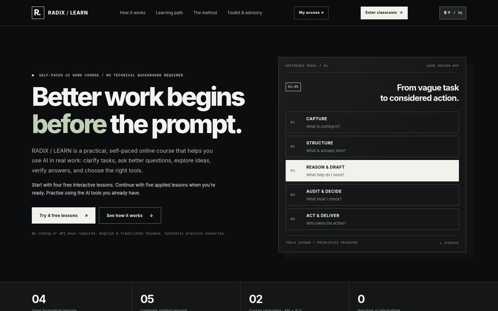
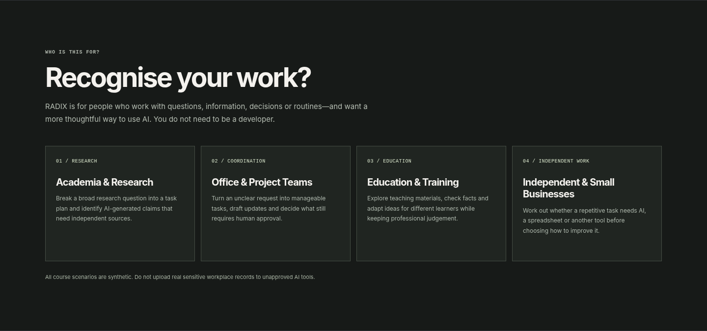
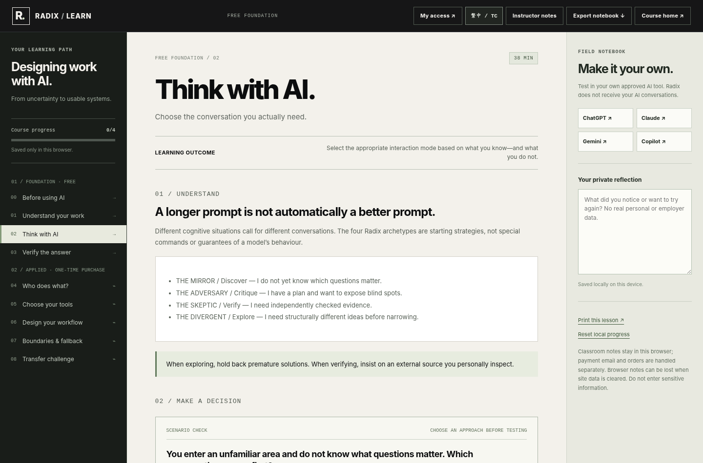
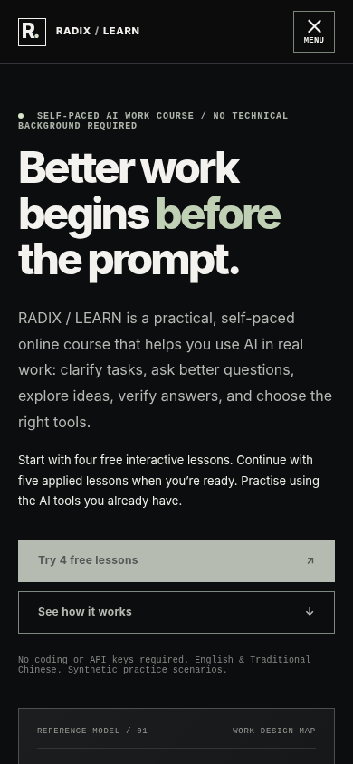
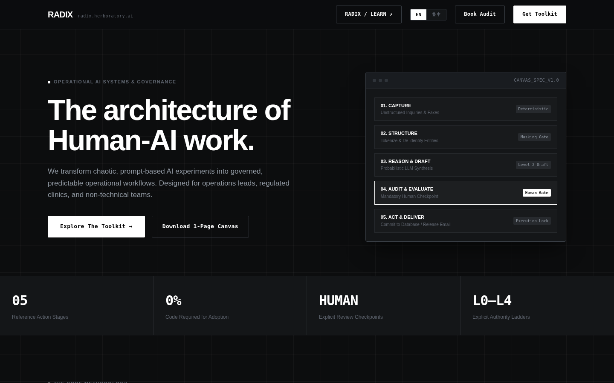

  <strong>English</strong> · <a href="./README.zh-TW.md">繁體中文</a>

  

# RADIX

**Better work begins before the prompt.**

RADIX is a practical, tool-agnostic AI work education and advisory initiative by **Herboratory**. We help people understand their work, collaborate more deliberately with AI, choose suitable tools, and design workflows that remain understandable and accountable.

It is **not another AI chatbot**. Learners practise using the AI tools they already have or the ones their organisation approves. No coding or model API integration is required to take the Foundation course.

**[Explore RADIX ↗](https://radix.herboratory.ai/)** &nbsp;·&nbsp; **[Try the four free lessons ↗](https://radix.herboratory.ai/learn.html)** &nbsp;·&nbsp; **[Explore Advisory ↗](https://radix.herboratory.ai/advisory.html)**

---

## What RADIX offers

| Offering | What it is | Access |
|:--|:--|:--|
| **Foundation** | Four interactive lessons on safe inputs, understanding work, thinking with AI and verifying results. | Free |
| **Applied Learning** | Five guided lessons on human/AI responsibilities, tool selection, workflow design, boundaries and transfer to new tasks. | Separate, one-time course purchase |
| **Professional Toolkit** | Downloadable Canvas, workbooks, interaction playbook, scenarios, tool-selection guide and related reference materials. English and Traditional Chinese editions are included together. | Separate, one-time toolkit purchase |
| **Workshops & Advisory** | Practical facilitation and scoped support for teams and organisations designing AI-assisted work. | Enquire separately |

The Toolkit is **not required** to start or complete the free Foundation lessons. Buying the Toolkit does not automatically include Applied Learning, and vice versa.

## Learn by doing — with your own AI

RADIX lessons use synthetic workplace scenarios and a repeatable practice loop:

**Read a scenario → Choose an approach → Try a prompt in your own AI → Reflect and verify → Apply the principle elsewhere.**

One example is choosing the right kind of AI conversation: **The Mirror** (discover unknowns), **The Adversary** (challenge an idea), **The Skeptic** (verify claims) or **The Divergent** (explore different directions).

The wider work-design approach considers five recurring actions: **Capture, Structure, Reason & Draft, Audit & Decide, Act & Deliver**. These are a flexible reference, not a compulsory linear process.

## Who is it for?

RADIX is designed to be approachable without a technical background, including people working in **Academia & Research**, **Office & Project Teams**, **Education & Training**, and **Independent & Small Businesses**. The method is transferable across disciplines rather than tied to a specific AI vendor.

## A look inside

| Interactive learning | Responsive access |
|:--|:--|
|  |  |

**Beyond the course:** RADIX also offers workflow architecture and advisory services for practical human–AI collaboration.

## Language and privacy

- Learning content is available in **English and Traditional Chinese (繁體中文)**.
- Practice exercises use synthetic scenarios; do not upload sensitive workplace records to an unapproved AI tool.
- RADIX does not require learners to connect their AI accounts to the classroom.
- Course and Toolkit purchases are managed on the official RADIX website, not through this GitHub repository.

---

### Explore the project

**Website:** https://radix.herboratory.ai/  
**Free classroom:** https://radix.herboratory.ai/learn.html  
**Advisory:** https://radix.herboratory.ai/advisory.html  
**Parent studio:** [Herboratory on GitHub](https://github.com/herboratory)

> **Showcase only.** This public repository contains brand information and selected marketing screenshots. It is not the RADIX source-code repository, a downloadable LMS, or a distribution point for paid course or Toolkit files.

© 2026 **Herboratory**. All rights reserved. See [NOTICE](./NOTICE.md).
